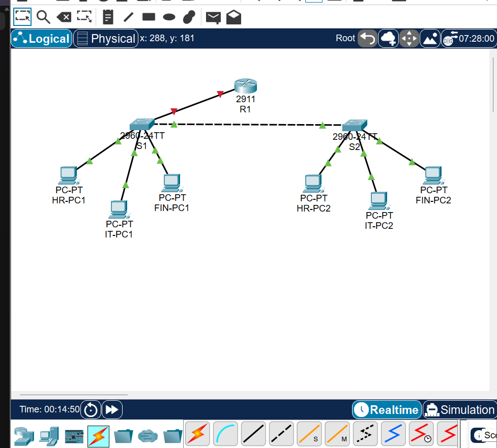
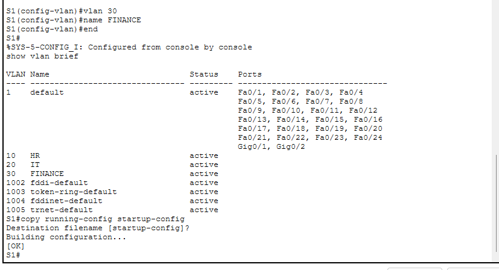
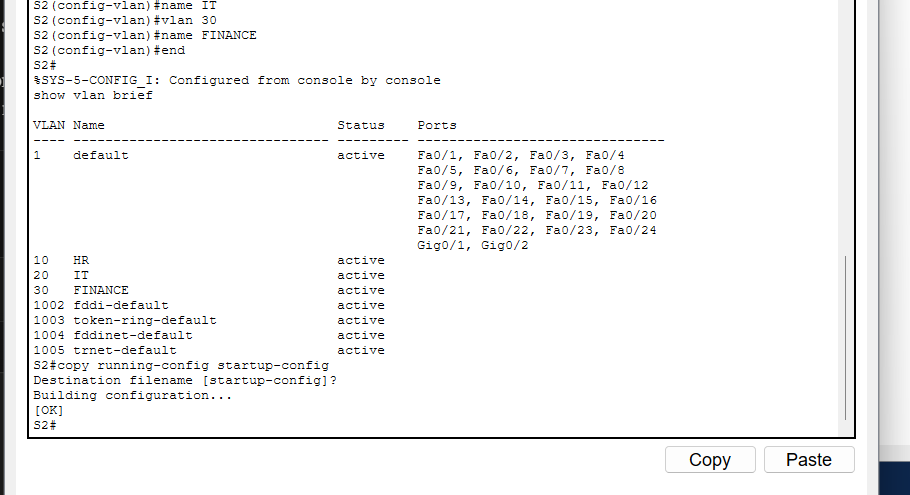
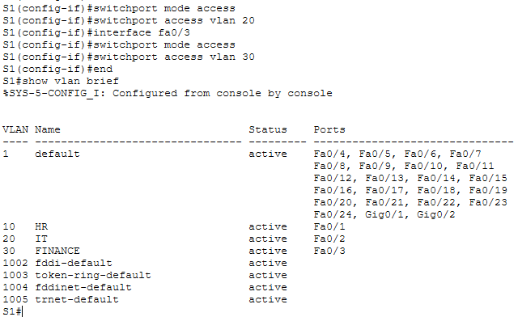
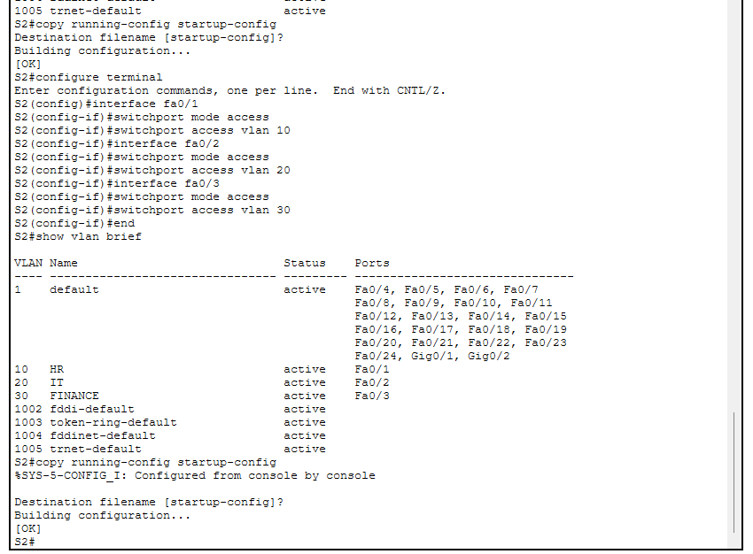
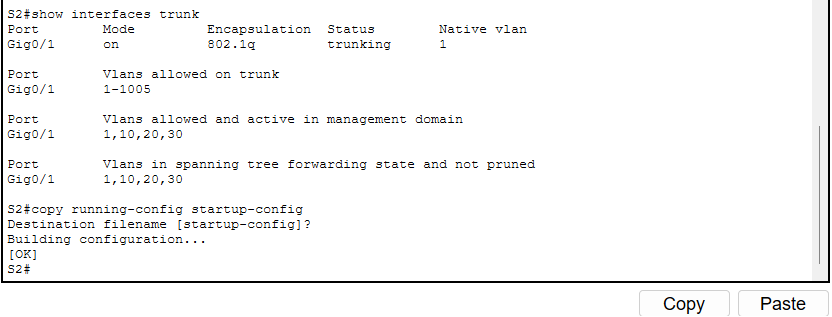
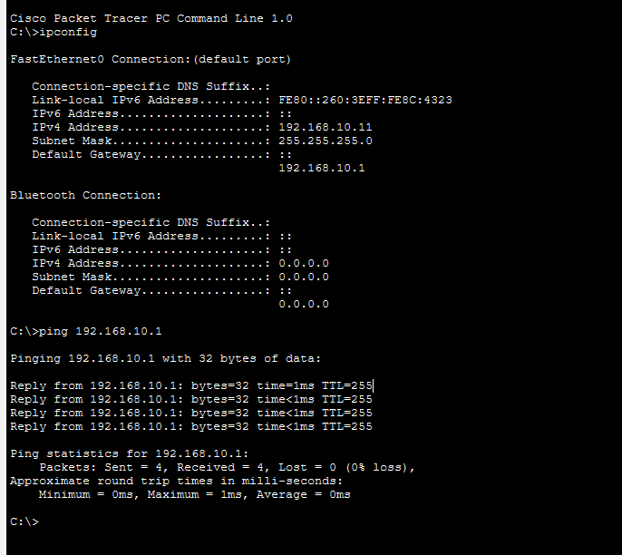
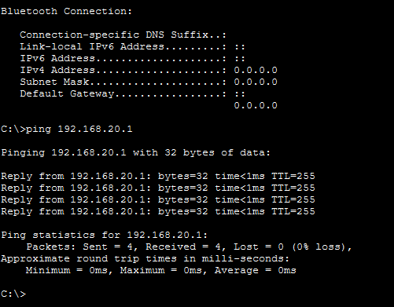
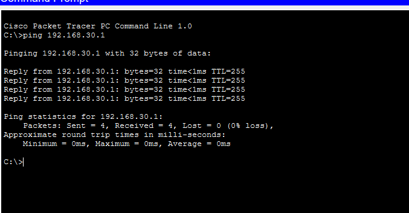

# Secure Office Network Using VLANs and Inter-VLAN Routing

**Name:** Riya Parmar
**Subject:** Computer Networking
**Software:** Cisco Packet Tracer
**Project file:** `RiyaParmar_VLAN_Routing_Project.pkt`

---

## 1. About the Project

For this project I acted as a junior network administrator for a small company with three departments: HR, IT and Finance. All of them were on one flat network, which means every broadcast reached every PC and there was no separation between departments.

My task was to split the network into three VLANs, connect them over two switches, and use a single router (Router-on-a-Stick) so the departments can still talk to each other when needed.

---

## 2. Network Topology



### Devices used

| Device | Model | Quantity |
|---|---|---|
| Router | Cisco 2911 (R1) | 1 |
| Switches | Cisco 2960 (S1, S2) | 2 |
| PCs | HR-PC1, HR-PC2, IT-PC1, IT-PC2, FIN-PC1, FIN-PC2 | 6 |

### Connections

| From | Port | To | Port | Cable |
|---|---|---|---|---|
| R1 | G0/0 | S1 | G0/1 | Copper straight-through |
| S1 | G0/2 | S2 | G0/1 | Copper cross-over |
| HR-PC1 | Fa0 | S1 | Fa0/1 | Copper straight-through |
| IT-PC1 | Fa0 | S1 | Fa0/2 | Copper straight-through |
| FIN-PC1 | Fa0 | S1 | Fa0/3 | Copper straight-through |
| HR-PC2 | Fa0 | S2 | Fa0/1 | Copper straight-through |
| IT-PC2 | Fa0 | S2 | Fa0/2 | Copper straight-through |
| FIN-PC2 | Fa0 | S2 | Fa0/3 | Copper straight-through |

I placed one PC from each department on each switch, so every department is spread across both switches. This shows that a VLAN can stretch across more than one switch.

---

## 3. VLAN Plan

| VLAN ID | Name | Department | Network |
|---|---|---|---|
| 10 | HR | Human Resources | 192.168.10.0/24 |
| 20 | IT | Information Technology | 192.168.20.0/24 |
| 30 | FINANCE | Finance | 192.168.30.0/24 |

On both switches, Fa0/1 is HR, Fa0/2 is IT and Fa0/3 is Finance.

---

## 4. IP Addressing

| Device | VLAN | IP Address | Subnet Mask | Default Gateway |
|---|---|---|---|---|
| HR-PC1 | 10 | 192.168.10.11 | 255.255.255.0 | 192.168.10.1 |
| HR-PC2 | 10 | 192.168.10.12 | 255.255.255.0 | 192.168.10.1 |
| IT-PC1 | 20 | 192.168.20.11 | 255.255.255.0 | 192.168.20.1 |
| IT-PC2 | 20 | 192.168.20.12 | 255.255.255.0 | 192.168.20.1 |
| FIN-PC1 | 30 | 192.168.30.11 | 255.255.255.0 | 192.168.30.1 |
| FIN-PC2 | 30 | 192.168.30.12 | 255.255.255.0 | 192.168.30.1 |

| Router Subinterface | VLAN | IP Address |
|---|---|---|
| G0/0.10 | 10 | 192.168.10.1/24 |
| G0/0.20 | 20 | 192.168.20.1/24 |
| G0/0.30 | 30 | 192.168.30.1/24 |

---

## 5. Configuration

### Switch S1

```
enable
configure terminal
hostname S1

vlan 10
 name HR
vlan 20
 name IT
vlan 30
 name FINANCE
exit

interface fa0/1
 switchport mode access
 switchport access vlan 10
interface fa0/2
 switchport mode access
 switchport access vlan 20
interface fa0/3
 switchport mode access
 switchport access vlan 30

interface g0/1
 switchport mode trunk
interface g0/2
 switchport mode trunk
end
copy running-config startup-config
```

### Switch S2

```
enable
configure terminal
hostname S2

vlan 10
 name HR
vlan 20
 name IT
vlan 30
 name FINANCE
exit

interface fa0/1
 switchport mode access
 switchport access vlan 10
interface fa0/2
 switchport mode access
 switchport access vlan 20
interface fa0/3
 switchport mode access
 switchport access vlan 30

interface g0/1
 switchport mode trunk
end
copy running-config startup-config
```

### Router R1 (Router-on-a-Stick)

```
enable
configure terminal
hostname R1

interface g0/0
 no shutdown
exit

interface g0/0.10
 encapsulation dot1Q 10
 ip address 192.168.10.1 255.255.255.0
exit
interface g0/0.20
 encapsulation dot1Q 20
 ip address 192.168.20.1 255.255.255.0
exit
interface g0/0.30
 encapsulation dot1Q 30
 ip address 192.168.30.1 255.255.255.0
end
copy running-config startup-config
```

**What I did and why:**

- **Created the VLANs on both switches.** Every switch needs to know about a VLAN before it can carry it. HR-PC2 is on S2, so if VLAN 10 didn't exist on S2, it couldn't join HR.
- **Set the PC ports as access ports.** An access port belongs to one VLAN only. This is how each PC gets placed in its department.
- **Set the switch-to-switch and router-to-switch links as trunks.** A trunk carries all VLANs on one cable. Each frame gets an 802.1Q tag so the other side knows which VLAN it belongs to.
- **Turned on the router port with `no shutdown`.** Router ports are off by default.
- **Created one subinterface per VLAN.** Since the router only has one cable to S1, I split G0/0 into three logical subinterfaces. `encapsulation dot1Q` tells each one which VLAN tag to accept, and its IP address becomes the default gateway for that department.

---

## 6. Verification Commands

### Switch commands

| Command | What it shows |
|---|---|
| `show vlan brief` | All VLANs and which access ports are in each one |
| `show interfaces trunk` | Which ports are trunks, their encapsulation (802.1Q) and which VLANs they carry |
| `show interfaces status` | Each port's status (connected or not), VLAN, speed and duplex |
| `show mac address-table` | Which MAC addresses the switch learned, and on which port and VLAN |
| `show running-config` | The full current configuration of the switch |

**S1 – VLANs created**

VLANs 10 (HR), 20 (IT) and 30 (FINANCE) exist. All ports are still in VLAN 1 because no access ports were assigned yet.



**S2 – VLANs created**



**S1 – show vlan brief (after assigning access ports)**

Fa0/1 is in HR, Fa0/2 in IT and Fa0/3 in FINANCE.



**S2 – show vlan brief (after assigning access ports)**

Same port layout as S1.



**S2 – show interfaces trunk**

Gig0/1 (the link to S1) is trunking with 802.1Q and carries VLANs 1, 10, 20 and 30.



### Router commands

| Command | What it shows |
|---|---|
| `show ip interface brief` | All interfaces with their IP addresses and up/down status |
| `show ip route` | The routing table. "C" means a directly connected network and "L" means the router's own address on that network |
| `show running-config` | The full router configuration, including the subinterfaces |
| `show interfaces` | Detailed info for each interface, like its MAC address, encapsulation, packet counts and errors |

After the router configuration, `show ip interface brief` showed G0/0 and all three subinterfaces as up/up, and `show ip route` listed a connected route for each VLAN network (192.168.10.0, 192.168.20.0 and 192.168.30.0).

### Gateway reachability

Before testing between PCs, I checked that each department could reach its own gateway on the router. All three pings got 4/4 replies with 0% loss, which confirms the access ports, the trunks and the router subinterfaces were all working.

**HR-PC1 → 192.168.10.1** (the PC's `ipconfig` output is also shown)


**IT PC → 192.168.20.1**


**Finance PC → 192.168.30.1**


---

## 7. Testing

### Test A: Same-VLAN Communication

| From | To | Result |
|---|---|---|
| HR-PC1 | HR-PC2 (192.168.10.12) | Success |
| IT-PC1 | IT-PC2 (192.168.20.12) | Success |
| FIN-PC1 | FIN-PC2 (192.168.30.12) | Success |

These PCs are in the same VLAN but on different switches, so the traffic went from S1 to S2 over the trunk. The router wasn't needed.

### Test B: Inter-VLAN Communication

| From | To | Result |
|---|---|---|
| HR-PC1 | IT-PC1 (192.168.20.11) | Success |
| HR-PC1 | FIN-PC1 (192.168.30.11) | Success |
| FIN-PC1 | HR-PC1 (192.168.10.11) | Success |

These PCs are in different VLANs, so the traffic had to go through the router. One thing I noticed is the TTL value. Same-VLAN replies came back with TTL=128, while inter-VLAN replies came back with TTL=127. The TTL drops by one every time a packet passes through a router, so this confirms that Test B traffic really went through R1.

### Test C: VLAN Isolation

I shut down the router's G0/0 interface and tested again.

**1. Can two PCs in the same VLAN still communicate?**
Yes. HR-PC1 could still ping HR-PC2. Traffic inside one VLAN is handled by the switches only, and it travels between S1 and S2 over the trunk.

**2. Can a PC in VLAN 10 communicate with a PC in VLAN 20?**
No. The ping from HR-PC1 to IT-PC1 timed out.

**3. Why does the router affect communication between VLANs but not within the same VLAN?**
Each VLAN is its own network. When a PC sends data to another PC in the same network, the switches deliver it directly using MAC addresses. When the destination is in a different network, the PC has to send the data to its default gateway, and the gateway is a subinterface on the router. With the router link down, the gateway can't be reached, so traffic between VLANs stops. Traffic within a VLAN never needs the gateway, so it keeps working.

After the test I brought the interface back up with `no shutdown`, and inter-VLAN pings worked again.

### Test D: Simulation Mode

I cleared the ARP cache on HR-PC1 (`arp -d`) and R1 (`clear arp-cache`), switched to Simulation Mode with only ARP and ICMP filters on, and sent a ping from HR-PC1 to FIN-PC1.

**1. How does the source PC find its default gateway's MAC address?**
HR-PC1 compares the destination IP (192.168.30.11) with its own network and sees that it's on a different network, so the packet has to go to the default gateway, 192.168.10.1. Its ARP table is empty, so it sends an ARP request as a broadcast inside VLAN 10, asking who has 192.168.10.1. The router's G0/0.10 subinterface replies with its MAC address.

**2. How does the Ethernet frame travel from the access switch to the router?**
The frame leaves HR-PC1 without any VLAN tag. S1 receives it on Fa0/1, which is an access port in VLAN 10. S1 adds an 802.1Q tag for VLAN 10 and sends it out of the trunk port G0/1 to the router.

**3. How does the router identify the correct outgoing interface?**
The frame arrives with a VLAN 10 tag, so G0/0.10 accepts it. The router removes the tag, looks at the destination IP address and checks its routing table. 192.168.30.0/24 is directly connected on G0/0.30, so the router sends the packet out of that subinterface with a VLAN 30 tag.

**4. What happens to the source and destination MAC addresses?**
They change. Before the router, the source MAC is HR-PC1 and the destination MAC is the router. After the router, the source MAC is the router and the destination MAC is FIN-PC1.

**5. Do the source and destination IP addresses change?**
No. The source stays 192.168.10.11 and the destination stays 192.168.30.11 for the whole trip, because there is no NAT. Only the TTL goes down by one at the router.

---

## 8. Troubleshooting Report

### Issues I came across while building the network

| Issue | What I saw | Cause | Fix |
|---|---|---|---|
| Router link stayed red | The cable between R1 and S1 had red lights right after cabling | Router interfaces are shut down by default | Ran `no shutdown` on G0/0 |
| S1 trunk to router not listed | `show interfaces trunk` on S1 only showed Gig0/2 | This command only lists trunks that are up, and the router port was still off | After turning on G0/0, Gig0/1 showed as trunking |
| First ping timed out | The first reply in some pings said "Request timed out" | The PC and router were still learning MAC addresses through ARP | Ran the ping again and all replies came back |

### Other common faults in this kind of setup

| Fault | Symptom | How to find it | Fix |
|---|---|---|---|
| Switch-to-switch link not a trunk | PCs in the same VLAN on different switches can't ping each other | `show interfaces trunk` doesn't list the port | `switchport mode trunk` on both ends |
| PC port in the wrong VLAN | A PC can't reach its own department | `show vlan brief` shows the port in the wrong VLAN | `switchport access vlan <correct VLAN>` |
| VLAN missing on one switch | PCs of that VLAN on that switch are cut off | `show vlan brief` doesn't list the VLAN | Create the VLAN on that switch |
| Wrong VLAN number in encapsulation | One department can't reach the others | `show running-config` on R1 | Correct the `encapsulation dot1Q` value |
| `ip address` entered before `encapsulation` | The router shows an error on the subinterface | Error message in the CLI | Enter `encapsulation dot1Q` first, then the IP |
| Wrong default gateway on a PC | Same-VLAN pings work but inter-VLAN pings fail | `ipconfig` on the PC | Set the gateway to the .1 address of its VLAN |

---

## 9. Conclusion

This project showed me how VLANs make a network easier to manage. By splitting the office into HR, IT and Finance VLANs, each department got its own broadcast domain, so broadcasts stay inside one department and the departments are separated from each other, even though they share the same switches. Trunk links let a single cable carry all three VLANs using 802.1Q tags, and Router-on-a-Stick allowed the departments to communicate through one router interface when they need to. The tests confirmed that traffic within a VLAN only needs the switches, while traffic between VLANs depends on the router.

---

## 10. Files in this Repository

| File | Description |
|---|---|
| `RiyaParmar_VLAN_Routing_Project.pkt` | Cisco Packet Tracer project file |
| `README.md` | This report |
| `Screen_Shots/` | All screenshots used in this report |
